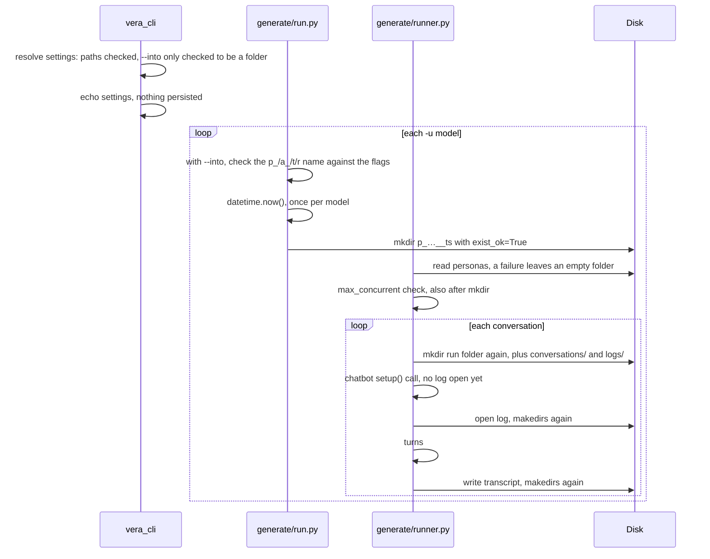
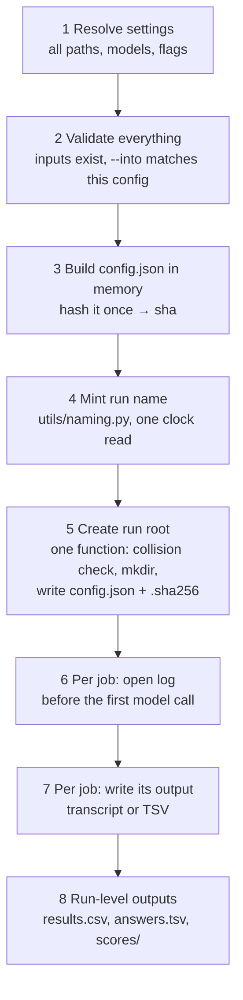

# Run lifecycle: one vocabulary, one order, enforced

**Status:** draft for discussion. Builds on the target layout in [vera-cli-use-cases.md, Naming](../vera-cli-use-cases.md) and AD-12 / AD-18 / AD-23 / AD-24 in [ARCHITECTURE-SPINE.md](../ARCHITECTURE-SPINE.md); delivers part of the roadmap's [Traceability](../roadmap.md#traceability) phase.

## Goals

1. **One vocabulary everywhere.** `c` chatbot, `u` user, `j` judge ([vera-cli-use-cases.md](../vera-cli-use-cases.md) lines 12–16). The CLI already uses it; output names, result files, and the code underneath still say persona/agent/provider.
2. **A written order of events.** For each command: when settings are final, when a name is chosen, when a folder appears, when the first file is written.
3. **That order enforced by tests**, not by convention.

## 1. Vocabulary

"Persona" keeps one meaning: the **character** in the personas file (Brian, Sarah). It stops meaning the user-side model. "Provider" keeps one meaning: the LLM **vendor** (`llm_clients/`). It stops meaning the chatbot.

### Public surface (what users type or read)

| Where | Today | After |
|---|---|---|
| `vera generate` flag | `--provider-speaks-first` | `--chatbot-speaks-first` (old flag removed; config key `generation.persona_speaks_first` → `generation.user_speaks_first`) |
| Generation run folder | `p_<user>__a_<chatbot>__t30__r1__<ts>` | `c_<chatbot>/u_<user>_<sha>_<ts>` (target layout) |
| Judge run folder | `j_<judge>x1_<params>_<ts>__p_…__a_…__<ts>` | `j_<judge>_<sha>_<ts>` inside the generation run |
| Pooled folder | `j_<j>__p_<u1+u2>__a_<c>__t__r__<ts>` beside the `p_` folders | `c_<chatbot>/pooled/u_<u1>+<u2>_<sha>_<ts>` |
| `scores.json` keys | `persona_model`, `agent_model` | `user_model`, `chatbot_model` |
| Charts, console | "Judge \| Persona \| Agent", "Agent Model:" | "Judge \| User \| Chatbot" |
| Generation logs | "LLM1 Configuration", "LLM2 Configuration" | "User model", "Chatbot model" |
| Transcript end line | raw role `persona` / `provider` | `user` / `chatbot` (the turn labels already are) |
| `--into` errors | name legacy flags `--user-agent`, `--provider-agent`, `--runs` | name `-u`, `-c`, `--repeats` |

Old run folders stay readable by explicit path (AD-23): `vera judge --conversations <old p_ folder>` and `vera score -r <old results.csv>` keep working. No migration script.

### Internal identifiers

| Today | After |
|---|---|
| `Role.PERSONA`, `Role.PROVIDER` | `Role.USER`, `Role.CHATBOT` |
| `persona_model_config`, `agent_model_config` | `user_model`, `chatbot_model` (a `ModelSpec`, once `_legacy_model_config` goes) |
| `llm1`, `llm2`, `llm1_model`, `llm1_prompt` | `user_llm`, `chatbot_llm`, … |
| `agent`, `name="Provider"` | `chatbot` |
| `runs_per_prompt` | `repeats` |
| `persona`/`agent` keys in name parsers | gone: metadata comes from `config.json`, not folder names (Traceability) |

The internal renames are mechanical but wide (about 400 `Role.*` uses in tests alone), so they land as their own PRs after the public surface.

## 2. Order of events

### Today, `vera generate` (the messiest case)

Problems this shows, all from the current code:

- **Names are built in four places** (`utils/naming.py`, `judge/utils.py`, `score/pool.py`, and parsers in `score/`, `judge/`, `utils/judge_results.py`), against AD-12.
- **Folders are created in about a dozen places**, all with `exist_ok=True`. AD-24 asks for exactly one collision check that errors; none exists, so two runs in the same second silently merge.
- **A folder can appear before validation fails** (personas file, `max_concurrent`), leaving an empty run behind.
- **Four clocks per pipeline.** Generation and pool use seconds, judge uses milliseconds, `pool_metadata.json` takes its own `created_at`.
- **Nothing persists the resolved settings.** No `config.json` is written yet.
- **The first chatbot call happens before its log exists** (`agent.setup()`).

### Target, every command

Rules that make this hold:

1. **Nothing touches disk before step 5.** Steps 1–4 are pure; any failure leaves no trace.
2. **One clock read per run**, in step 4. Every timestamp the run writes (folder name, `config.json`, `pool_metadata.json`) is that value.
3. **One function creates run roots**: `create_run_root(parent, name, config)` in `utils/`. It errors if the folder exists (AD-24), creates it with the fixed subfolders (`conversations/`, `logs/`, …), and writes `config.json` and its `.sha256`. Resume (`--into`) is the only caller that opens an existing root, and only after step 2 has checked the root's `config.json` against the current settings.
4. **Every path below the root comes from `utils/naming.py`.** Domain code receives paths; it never joins `"evaluations"`, `"logs"`, `"scores"` itself.
5. **Logs open before the first model call**, including `setup()`.

In a pipeline, steps 1–3 run once for the whole pipeline; each stage then repeats 4–8 for its own run root, nested inside the previous stage's (judge inside generation, pooled under the chatbot folder).

## 3. Enforcement

Unit tests that fail the build, each a few lines:

- **No stray folder creation.** Scan `generate/`, `judge/`, `score/`, `vera_cli/` with `ast` for `mkdir` / `makedirs`; fail on any call outside `utils/run_root.py` and the per-job writers it hands paths to.
- **No stray clocks.** Same scan for `datetime.now()` / `time.time()` in naming paths; timing-only uses carry an explicit allow-list entry.
- **No hand-built layout names.** Fail on the string literals `"evaluations"`, `"conversations"`, `"logs"`, `"scores"`, `"answers"` outside `utils/naming.py` and `utils/conversation_layout.py`.
- **Order of events.** One test per command with mocked LLMs and a fake filesystem that records events; assert the sequence (config written before any transcript, log opened before the first model call, nothing written when validation fails).
- **Collision.** Creating the same run root twice raises.

Import-linter can't see calls, which is why these are AST tests rather than contracts.

## Bugs found while mapping this (fixable now, independent of the design)

| Bug | Where |
|---|---|
| `results.csv` `run_id` holds only the generation timestamp (rebuild splits on `__`, which the run ID itself contains); in-memory rows hold the literal `"conversations"` | `utils/judge_results.py` rebuild; `judge/rubric_config.py:574` |
| `vera generate --into` with more than one `-u` passes the same folder to every model; model 2 fails only after model 1 finished | `generate/run.py:202,209` |
| Resume misses personas whose name has a space or dot (filename uses the raw name, resume matches a normalized one) | `generate/runner.py:381` vs `utils/naming.py:59` |
| `vera judge --into` checks only "is a dir": no check that judge models, params, rubric, or conversations match | `judge/run.py:106` |
| Generation creates its folder before loading personas and checking `max_concurrent`; a failure leaves an empty run | `generate/run.py:121` |
| `vera score -o` sends the JSON to `-o` but the charts to `<results dir>/scores/` | `score/run.py`, `score/viz.py` |
| `pipeline` accepts `invocation.into` from a config file: generation resumes but judging starts a fresh folder | `vera_cli/pipeline.py` |

## Docs to reconcile

1. `architecture.md:46` writes `j_<judge>_<timestamp>_<sha>` (timestamp before sha); everywhere else the timestamp goes last.
2. Requested and resolved model IDs: `config.json` per `vera-cli-use-cases.md:375`, `state.json` per `architecture.md:368` and AD-18.
3. Target transcripts are `.json`; the code writes `.txt` and the judge globs `*.txt`.

## Plan

1. **Bug fixes above**, each its own small PR. No design dependency.
2. **Public vocabulary**: flag, `scores.json` keys, charts, logs, error messages. Changes user-visible output; CHANGELOG entry.
3. **`create_run_root` + one clock + paths from `utils/naming.py`**, with the enforcement tests, still writing today's folder names. Moves every mkdir behind one function.
4. **Target layout and `config.json`** (Traceability): new names, nested judge runs, pooled under the chatbot.
5. **Internal renames** (`Role`, `llm1`/`llm2`, `persona_model_config`, …), mechanical, after `legacy/` is gone so legacy's own names don't have to be kept alive.

## Open questions

1. **`--chatbot-speaks-first` vs `--user-speaks-first`.** Today the default is that the user (persona) speaks first and the flag flips it. Keep the flag as a switch, or make it `--first-speaker user|chatbot`?
2. **Step 3 before step 4.** Writing `config.json` in memory before minting the name lets the `<sha>` go into the folder name (as specified). It also means `--print` can show the exact folder a run would create. Worth making `--print` show it?
3. **Transcript format.** Move to `.json` now (as the target layout says), or keep `.txt` and fix the doc?
